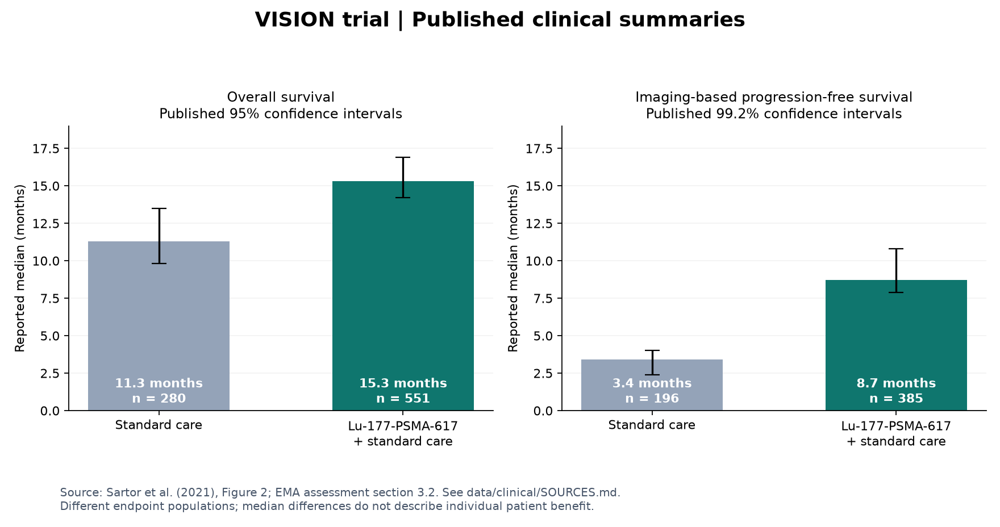
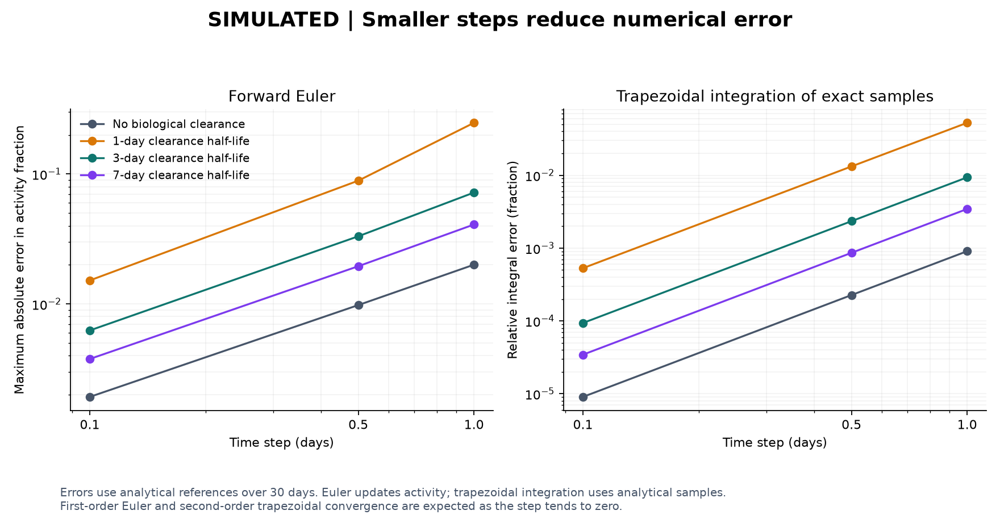

# PSMA Radiopharmaceuticals: Clinical Outcomes and a Physics Simulation

PHYS 220 — Computational Methods for Physics and Engineering. A Python project developed with Codex assistance; the student should review, understand, and explain the code and disclose AI use according to course policy.

**Research question:** What outcomes were reported for Lu-177-PSMA-617 in the VISION trial, and how do physical decay and hypothetical biological clearance change simulated retained activity?

This project has two distinct parts: analysis of published clinical summaries and an educational physics simulation. The simulation does not predict clinical efficacy.

## Run the project

Python 3.13 is installed on the development computer. Open PowerShell **in this project folder** and use the local virtual environment:

```powershell
.\.venv\Scripts\python.exe run_analysis.py
```

On a fresh Windows computer with Python 3.13, create the environment and install dependencies first:

```powershell
py -3.13 -m venv .venv
.\.venv\Scripts\python.exe -m pip install -r requirements.txt
.\.venv\Scripts\python.exe run_analysis.py
.\.venv\Scripts\python.exe -m unittest discover -s tests -v
```

If `py` is unavailable on this development computer, the installed interpreter is at `%LOCALAPPDATA%\Programs\Python\Python313\python.exe`. In PowerShell, run `& "$env:LOCALAPPDATA\Programs\Python\Python313\python.exe" -m venv .venv` instead of the first command. Open a new terminal after installation to refresh PATH.

On macOS/Linux: `python3 -m venv .venv`, then `.venv/bin/python -m pip install -r requirements.txt` and `.venv/bin/python run_analysis.py`. Only Windows is tested here.

No environment activation is needed. Dependency installation requires internet; analysis and tests use local files and run offline. The default output is `results/`. You can select another location with `--output-dir another-folder`. A run overwrites generated files with the same names.

Development versions: Python 3.13.17, NumPy 2.5.5, pandas 2.3.3, and Matplotlib 3.11.2. Direct library versions are pinned in `requirements.txt`.

## Clinical analysis

The input is four aggregate endpoint/arm rows from VISION, not individual patient records. The treatment arm received Lu-177-PSMA-617 plus protocol-permitted standard care; the control arm received protocol-permitted standard care alone.

| Published endpoint | Treatment median | Control median | Calculated difference |
|---|---:|---:|---:|
| Overall survival | 15.3 months | 11.3 months | 4.0 months |
| Imaging-based progression-free survival | 8.7 months | 3.4 months | 5.3 months |



The input preserves endpoint-specific analysis populations and confidence levels. The figure shows published confidence intervals around medians. The program subtracts medians; it does not compute new confidence intervals, p-values, or hazard ratios. Published hazard ratios are retained as context.

The source study enrolled previously treated PSMA-positive metastatic castration-resistant prostate cancer patients. These results do not generalize to every PSMA-expressing cancer. Medians are survival-analysis estimates: subtracting them does not mean every treated patient lived that many additional months. The dataset cannot support patient-level fitting, independent significance testing, or reconstructed survival curves. Safety and quality of life are outside this analysis, so it is not a complete benefit-risk assessment.

Primary reference: [Sartor et al., NEJM (2021)](https://doi.org/10.1056/NEJMoa2107322); [accessible abstract and figure captions](https://pubmed.ncbi.nlm.nih.gov/34161051/). Median interval cross-check: [EMA assessment, section 3.2, printed p. 113](https://www.ema.europa.eu/en/documents/assessment-report/pluvicto-epar-public-assessment-report_en.pdf). Detailed extraction notes and access limitations: [data/clinical/SOURCES.md](data/clinical/SOURCES.md).

## Physics and numerical methods

Model one hypothetical compartment after a single administration, with initial normalized activity equal to 1 and constant decay/removal rates. There is no uptake phase, redistribution, or repeated dosing.

\[
\lambda_p = \frac{\ln 2}{T_p}, \qquad
\lambda_b = \frac{\ln 2}{T_b}, \qquad
k = \lambda_p + \lambda_b
\]

\[
\frac{d(A/A_0)}{dt}=-k(A/A_0), \qquad
\frac{A(t)}{A_0}=e^{-kt}
\]

The physical half-life is **6.647 days**, from [MIRDspecs, Lu-177 decay data](https://mirdsoft.org/products/MIRDspecs/MIRDspecs_HTMLs/Lu-177.htm). The biological half-lives—1, 3, and 7 days—are hypothetical scenarios, not measured patient parameters. The no-clearance case uses `lambda_b = 0`. Removal leaves the modeled compartment; radioactive material may still decay elsewhere.

Forward Euler approximates the differential equation at discrete times:

\[
a_{i+1}=a_i(1-k\Delta t_i), \qquad a_i=A(t_i)/A_0.
\]

The code rejects time steps with `k * dt > 1`, which would create negative activity. It samples 30 days at steps of 1, 0.5, and 0.1 day. The final step is shortened when necessary to reach the requested end time exactly.

The trapezoidal rule integrates analytical samples, isolating quadrature error:

\[
I_{trap}=\sum_i\frac{a_i+a_{i+1}}{2}(t_{i+1}-t_i), \qquad
I_{exact}=\frac{1-e^{-kT}}{k}.
\]

The output also integrates Euler samples to show the combined ODE and quadrature error. Compare the Euler maximum absolute activity error and trapezoidal relative integral error as the step shrinks. Forward Euler is first order; trapezoidal quadrature is second order for this smooth function. Three step sizes illustrate convergence, not a proof for arbitrary models.

Because activity is normalized, cumulative activity has units of **days**. It is not absorbed dose, tumor killing, or a clinical response probability. The clinical analysis and simulation are not fitted or linked quantitatively.

At a 0.1-day time step, the generated results are:

| Hypothetical clearance half-life | Exact 30-day normalized integral (days) | Trapezoidal relative error (%) | Maximum Euler activity-fraction error |
|---|---:|---:|---:|
| No clearance | 9.169683 | 0.000906 | 0.001926 |
| 1 day | 1.254033 | 0.052985 | 0.015175 |
| 3 days | 2.982020 | 0.009370 | 0.006255 |
| 7 days | 4.907778 | 0.003444 | 0.003772 |

For example, with a hypothetical 3-day clearance half-life, the exact integral is about 2.982 days, compared with 9.170 days for physical decay alone. This comparison concerns retention in the model only. The relative-error column above is in percent; the CSV stores fractions, so multiply by 100 to obtain percent.



## Files and outputs

| File | Purpose |
|---|---|
| `data/clinical/vision_summary.csv` | Cited published endpoint/arm summaries |
| `src/clinical.py` | Validate inputs and calculate descriptive differences |
| `src/simulation.py` | Analytical decay, Euler steps, integration and errors |
| `run_analysis.py` | Run everything and generate graphs |
| `results/clinical/comparison.csv` | Two endpoint comparisons |
| `results/clinical/median_outcomes.png` | Clinical medians and published intervals |
| `results/simulated/time_series.csv` | 1,572 simulated samples across 12 scenario/step combinations |
| `results/simulated/convergence.csv` | 12 integration and numerical error summaries |
| `results/simulated/activity_retention.png` | Analytical curves and coarse Euler samples |
| `results/simulated/cumulative_activity.png` | Analytical and trapezoidal cumulative activity |
| `results/simulated/numerical_convergence.png` | Error versus step size |
| `tests/` | Scientific, input-validation, and output checks |
| `docs/video-outline.md` | Suggested short presentation structure |

Blank `biological_half_life_days` in simulation CSVs means **no biological clearance**, not unknown measured patient data. `data_type` and `scenario` identify simulated outputs explicitly. All simulation results are deterministic; no random seed is needed.

## Git and public GitHub repository

Git tracks local history; GitHub hosts a copy that your professor can access. Use small meaningful commits as you develop and understand the project:

```powershell
git status
git diff
git add README.md
git diff --cached
git commit -m "Explain the numerical method"
```

Stage only files you intend to share. `.venv`, caches, and `.env` files are ignored. The current development branch is `codex/psma-analysis`.

The intended public repository is [Nasir-Jones/psma-radiopharmaceutical-analysis](https://github.com/Nasir-Jones/psma-radiopharmaceutical-analysis). The `origin` remote is configured to that URL. To upload this project's branch:

```powershell
git push -u origin codex/psma-analysis
```

Git may open a browser for authentication through Git Credential Manager. Enter credentials only into GitHub's own sign-in flow, never in chat or source files. Never force-push to resolve an unexpected history.

After publication, share the repository's browser URL with your professor. Further verified commits can be uploaded with `git push`. Someone cloning the repository should follow the fresh-environment setup above; virtual environments are not uploaded.
